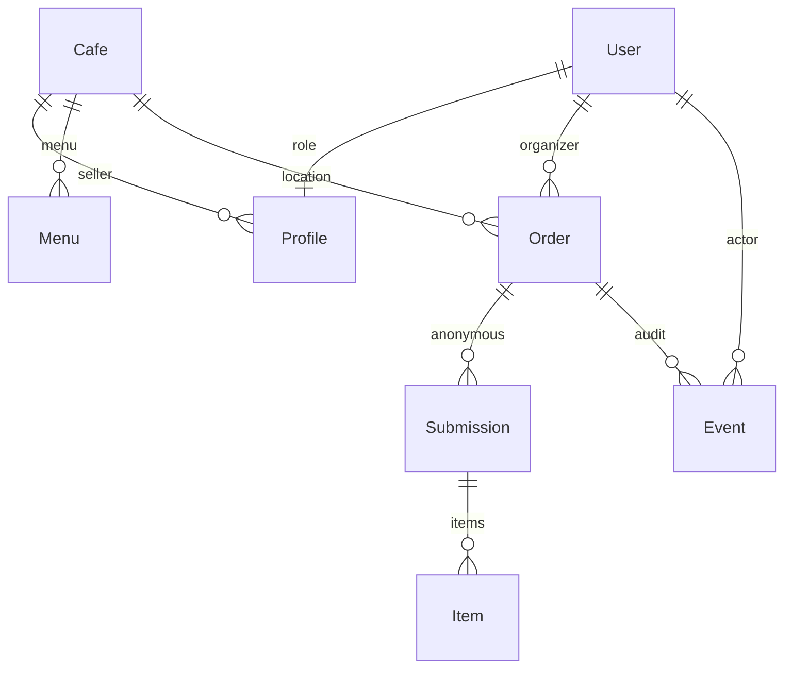

# DB 관계·일관성

모델은 orders/models.py, 마이그레이션은 orders/migrations/. RequestRecord는 (scope, key) UNIQUE, 요청 내용 SHA-256, 응답을 저장한다. 동일 요청 재시도는 기존 결과, 내용이 다르면 충돌. 요청 원문·비밀번호는 DB에 저장하지 않는다. LoginAttempt는 로그인 제한용 HMAC 식별자와 시각만 5분 저장한다.

Profile.nickname_key는 NFC·casefold 정규화 후 UNIQUE. 공백은 양끝만 제거하고 내부 공백은 허용하지 않는다. 역할은 총무·판매자·운영자. User.is_active와 Profile.active를 보호된 요청마다 검사한다. 참여 링크 token과 제출 receipt는 독립적인 256비트 난수이다. receipt 보유자만 해당 최초 제출을 조회하고 order token으로 다른 제출을 조회할 수 없다. 토큰은 URL 능력 키이므로 공유·로그 보관에 주의한다. 앱 로그는 토큰을 가린다.

Order는 생성 시 매장·메뉴·옵션·가격·총무 닉네임 스냅샷, 전송 시 final_snapshot을 보관한다. Submission은 동일 이름도 별도 ID. Item은 최초 수량·단가·스냅샷을 보존하고 유효 수량·삭제 표시만 바꾼다. Event는 이전/이후 상태·처리자·DB 시각·수량 변경 전후·거절 사유를 저장한다. 시스템 자동 취소는 actor=NULL과 auto_cancel로 구분. 자동 취소의 occurred_at은 실제 deadline, recorded_at은 처리 시각이다.

정수 원 단위. 옵션 조합은 정렬된 ID로 결정되고 메뉴·옵션 전체 스냅샷으로 집계하여 다른 옵션을 합치지 않는다. 필수 옵션 그룹은 하나씩 선택. 브라우저 합계·가격·역할은 신뢰하지 않는다.

모든 업무 쓰기는 SQLite `BEGIN IMMEDIATE`를 사용하는 transaction.atomic() 안에서 실행한다. 권한·상태·기한·매장 활성화·버전·쓰기·이력이 함께 처리된다. 쓰기 잠금은 최대 20초 기다리고 실패하면 트랜잭션을 롤백한다. 서비스 레이어는 그 실패를 성공으로 보고하지 않으며 프론트엔드는 불확실한 요청의 동일 키를 유지한다. 권한 검사는 목록·상세·폴링·쓰기 모두 동일한 조건을 적용한다. 페이지당 20건, 정렬 생성 시각 내림차순.

보호 관계는 PROTECT. 판매자 삭제는 soft delete이며 주문·메뉴·매장·변경 이력 물리 연쇄 삭제 없음. 사용자가 따로 요청하지 않은 관리자 주문 취소 API는 없다. DB는 서버의 OS 계정만 읽으며 공유 브라우저 DB 자격증명은 제공하지 않는다. 이 구성은 단일 앱 서비스 역할이지 멀티테넌트 DB 사용자별 RLS가 아니다.

DB 백업은 sqlite3 online backup API, integrity_check·foreign_key_check. 실제 서비스 이전 시 스키마 마이그레이션과 스냅샷 JSON 호환성을 유지하고 복원 리허설 후 전환한다. 금액·상태·이력을 직접 수정하지 않는다.
